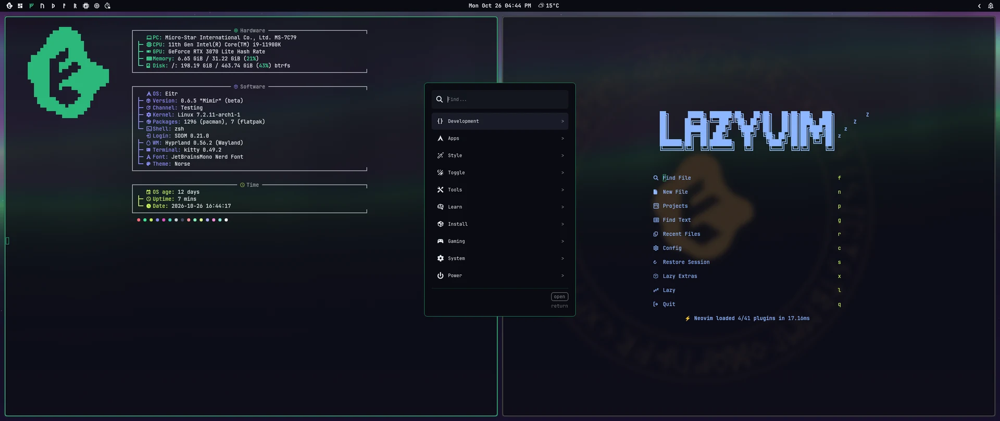

# Eitr

<p align="center">
  
</p>

An Arch-based Linux desktop built around Hyprland, Quickshell and a consistent,
theme-aware experience: one offline installer that takes about two minutes on a
fast machine, a ready graphical desktop after the first reboot, and safe updates
you can undo.

<p align="center">
  
</p>

Website and download: **https://eitr.info**

Eitr is free and open source. If it helps you, you can support its development
on [GitHub Sponsors](https://github.com/sponsors/erickbatistaprado).

**Status:** beta. The current release, its codename and the roadmap are in
[distro/RELEASES.md](distro/RELEASES.md). Eitr is used daily on its developer's
desktop and every ISO is tested in virtual machines (offline install, updates and
both factory resets). Hardware we have not tested yet, such as other laptops and
GPUs, may still need fixes; please [report problems](https://github.com/eitr-org/eitr/issues).

## Desktop

- A custom Quickshell bar with joined, animated panels: audio, network,
  Bluetooth, display (brightness, nightlight, resolution, refresh rate and scale),
  calendar, weather, hardware, AI usage limits and a control center.
- Native notifications with grouped stacks, history and Do Not Disturb.
- Workspace Overview with live previews; 25 dark and light themes with matching
  wallpapers, lockscreens and application colors. Each realm theme has two to
  four original wallpapers, from ink and gouache to painted environments, in
  both aspect ratios.
- Walker menus for apps, tools, settings and installs; typing searches every menu.
- Tools: screenshots, screen recording, OCR, QR codes, color picker, LocalSend
  sharing, reminders, a calculator and offline dictation (hold `Super + D`).
- The EITR Handbook: an offline guide to everything, opened with `Super + F1`.
- Kitty, Zsh, Neovim/LazyVim, Lazygit and Lazydocker; optional installs for
  languages, databases, developer apps, browsers and AI coding assistants.

## Safety and recovery

- System Update takes a Btrfs snapshot first and shows Arch news before updating;
  the boot guard rolls back an update after which the system no longer starts.
- Factory reset back to the first login, keeping your files or erasing everything.
- Optional hourly home-folder snapshots with restore of single files or folders.
- A firewall on by default, and stable or testing update channels.

## Getting started

Download the ISO from **https://eitr.info**, write it to a USB drive and boot it.
The guided installer erases the disk you choose (or installs beside Windows) and
installs the complete desktop offline, so no downloads are needed during setup.
After the reboot you reach Eitr's login screen and a ready desktop.

[The installation guide](distro/README.md) covers the guided and unattended
installs, building the ISO yourself and installing onto an existing Arch system
with Btrfs root (`bash distro/install.sh --check`, then `bash distro/install.sh`).
Package defaults are recorded in [distro/](distro/README.md). Credentials and
account state are never part of the installation.

`eitr` lists the available terminal commands; `eitr version` prints the release,
and `eitr about` opens or focuses the About window.

## Everyday shortcuts

- `Super + Space`: search applications.
- `Super + F`: open the main menu.
- `Super + Tab`: toggle Workspace Overview.
- `Super + N`: open the notification center.
- `Super + /`: open Learn's shortcut list.
- `Super + F1`: open the EITR Handbook.
- `Super + D` (hold): dictate; release to type what you said.
- `Super + Ctrl + Shift + N`: open the theme carousel.

Inside Overview, arrows select, Enter switches, numbers jump, and Escape closes.

## Repository layout

Most top-level directories mirror `~/.config`. `HOME_FILES/` holds files installed
elsewhere in the user's home directory. `distro/` owns package manifests, hardware
detection, installation scripts, and the ISO recipe. `branding/` holds the logo.

The shared Hyprland config uses a generic, automatic monitor layout. Settings for
one machine (monitor modes, workspace rules, input devices) go in an optional,
Git-ignored `~/.config/hypr/local.lua`; see
[monitors and machine-local overrides](distro/README.md#monitors-and-machine-local-overrides).
On the original desktop, copy `hypr/local.lua.example` to
`~/.config/hypr/local.lua` and `hypr/preferred-outputs.example` to
`~/.config/hypr/preferred-outputs`.

More details: [desktop shell](quickshell/desktop-bar/README.md),
[lockscreen and login](quickshell/lockscreen/README.md),
[Walker](walker/README.md), [About](fastfetch/README.md),
and [branding](branding/README.md).

## Development

Keep changes focused, preserve existing workflows, and follow [AGENTS.md](AGENTS.md).
Run the tests relevant to your change; do not test disruptive hardware actions
on an active session. Installs, updates and resets are tested in virtual machines
([distro/vm-tests](distro/vm-tests/eitr-vm-test), see
[LINUX-VM-TESTING.md](distro/LINUX-VM-TESTING.md)). Releases follow
[distro/RELEASES.md](distro/RELEASES.md) and [PUBLISHING.md](PUBLISHING.md).

## License

EITR's code and configuration are licensed under the GNU General Public License,
version 3 or (at your option) any later version; see [LICENSE](LICENSE).
Components with their own licenses keep them: the lockscreen layouts
(GPL-3.0, `quickshell/lockscreen/LICENSE`) and `nvim/`. Wallpapers,
lockscreen backgrounds and screenshots are CC BY 4.0, and the EITR logo is
reserved for EITR; see [artwork licensing](distro/ARTWORK-LICENSING.md).
Packages the installer offers keep their own licenses. [NOTICE.md](NOTICE.md) lists
every third-party component, its license and where to get its source.

## Checks

`tools/check.sh` runs every repository check: Python and Node test suites,
`bash -n`/`py_compile`/`luac -p` syntax checks, ShellCheck (warnings and errors),
Qt 6 qmllint, whitespace, and JSON/TOML parsing. Files are discovered with
`git ls-files`, so new tests and scripts are picked up automatically. CI runs the
same script in an Arch Linux container (`.github/workflows/ci.yml`).

```sh
bash tools/check.sh                  # all stages; run as a normal user
bash tools/check.sh shellcheck qml   # selected stages (see --list)
```

On a non-Arch host, run it from a regular clone in a throwaway Arch container.
The checkout is mounted read-only and copied, so its file ownership is untouched:

```sh
docker run --rm --platform linux/amd64 -v "$PWD":/repo:ro archlinux:latest bash -c 'sed -i "/^\[options\]/a DisableSandbox" /etc/pacman.conf && pacman -Syu --noconfirm --needed bash git python python-pillow python-gobject nodejs shellcheck lua qt6-declarative jq util-linux xkeyboard-config >/dev/null && useradd -m tester && cp -a /repo /home/tester/eitr && chown -R tester: /home/tester/eitr && su tester -c "cd ~/eitr && bash tools/check.sh"'
```
